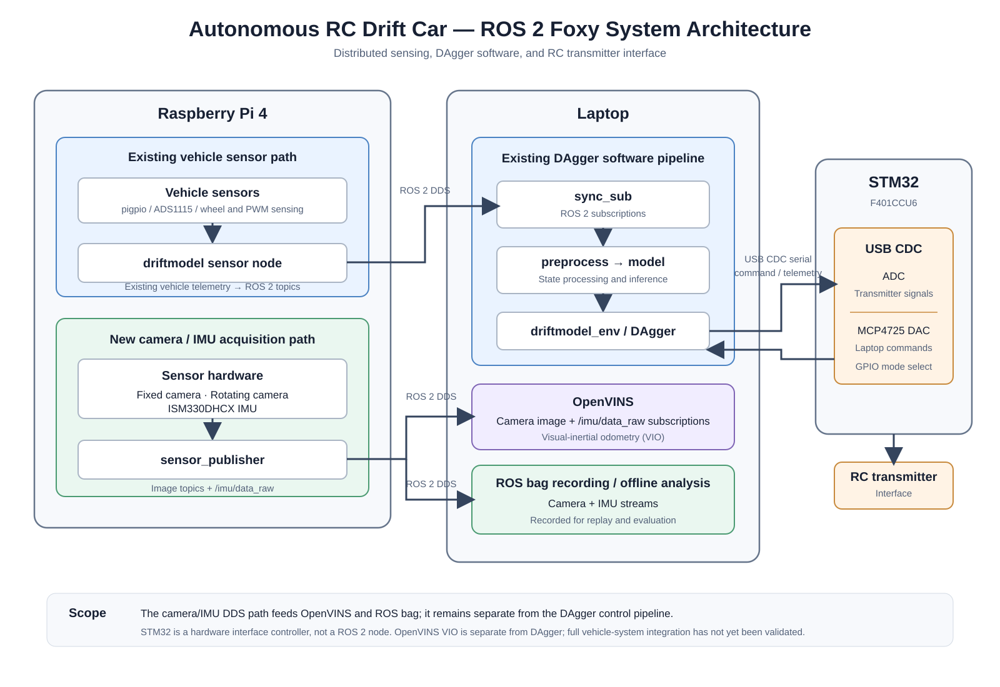

# Autonomous RC Drift Car

A 1/10-scale autonomous RC drift car project focused on vehicle-state estimation, motion control, and learning-based autonomous drifting.

## Project Overview

The goal of this project is to develop an RC car that can perform controlled drifting maneuvers autonomously. The system combines vehicle sensor data, ROS-based communication, and learning-based control.

The repository contains development work across different ROS environments:

- **Foxy** (this branch): ROS 2 version of the Raspberry Pi sensor packages, the STM32 controller firmware and the laptop-side learning pipeline.
- **Noetic** (`noetic` branch): ROS 1 prototype, including the imitation-learning-based drift control package.

## Problem and Approach

**The problem.** In a drift the heading of the car and its direction of travel differ; the angle between them is the slip angle. A 1/10-scale car has no GPS indoors, so this angle cannot be read from a sensor directly, and the tire and surface dynamics are hard to describe with a hand-made model. Two questions follow:

1. How can the slip angle be measured on a small car indoors?
2. How can a controller be built without a dynamics model?

**Slip angle from two cameras.** The idea comes from Stanford's autonomous drifting DeLorean ("Marty"), which compared the directions given by two RTK GPS receivers. Here a fixed camera gives the heading reference and a second camera on a servo follows the steering, so it looks along the direction the wheels point. The difference between the optical-flow directions of the two cameras is meant to give the slip angle. The rotating camera shares the gyro-corrected steering signal with the front servo through a Y-cable, so no extra control code is needed.

**State from low-cost sensors.** An ISM330DHCX IMU, per-wheel hall sensors, the motor hall signals and a current sensor feed the state vector. Motor current is included as an estimate of the motor torque.

**Control by imitation.** A human drives with the transmitter and the policy learns from these demonstrations (behavior cloning). A policy that only sees the states of the human's driving fails once it drifts away from them, so DAgger is used: the policy drives, the human's commands for the states it visits become new labels, and the dataset grows over several iterations. The command is mixed as `beta * human + (1 - beta) * policy` with `beta = 0.9^n`, so the policy takes over gradually. The policy is a small MLP (20 inputs, 11 and 5 hidden units, steering and throttle outputs) that runs on the laptop.

**The hardware interface.** An STM32 board sits between the transmitter and the car. A multiplexer selects either the transmitter signals or the two DAC outputs driven by the laptop, so the human can take over with a switch. A second switch gives a punishment signal for the reward.

### What is implemented

| Part | Status |
|---|---|
| Camera streaming (fixed and rotating) | Built and verified on the Raspberry Pi |
| IMU with startup gyroscope bias calibration | Built and run on the Raspberry Pi |
| Vehicle sensor node (wheel speed, motor speed, current) | Unit-tested on a PC, not run on the car |
| STM32 controller firmware (multiplexer, DACs, USB) | Source in this repository, not tested with the laptop |
| State synchronization, preprocessing, training and DAgger loop | Tested on a PC with fake inputs |
| Visual-inertial odometry and slip angle estimation | Not ported to Foxy yet |
| DAgger run on the car | Not done yet |

## System Architecture



The diagram shows the current ROS 2 Foxy architecture: the Raspberry Pi 4 publishes vehicle telemetry and camera/IMU data over ROS 2 DDS; the laptop runs the DAgger software, the separate OpenVINS VIO pipeline, and rosbag recording; and the STM32F401CCU6 provides the USB-connected RC transmitter signal interface. OpenVINS is not yet integrated into the DAgger perception/control pipeline, and full vehicle-system integration has not yet been validated.

The Raspberry Pi and the laptop exchange the ROS 2 topics over the network (Wi-Fi).

| Topic | Message | Source | Rate |
|---|---|---|---|
| `/camera/fixed/image_raw`, `/camera/rotating/image_raw` | `sensor_msgs/Image` (mono8, 640 x 480) | `sensor_publisher` | 30 FPS per camera (configured) |
| `/imu/data_raw`, `/imu/data_calibrated` | `sensor_msgs/Imu` | `sensor_publisher` | 208 Hz configured, about 221 Hz measured |
| `/sensors` | `driftmodel_msg/Sensors` (motor rpm, four wheel speeds, `tire_pwm`, current) | `driftmodel` | 60 Hz (configured) |
| `/ctrl_val` | `driftmodel_msg/CtrlVal` (steering, throttle, mode, punishment) | `usb_receiver` | 100 Hz |
| `/loop_fusion_node/odometry_rect` | `nav_msgs/Odometry` | visual-inertial odometry | - |

`driftmodel_env` joins odometry, IMU, `/sensors` and `/ctrl_val` with an `ApproximateTimeSynchronizer` (0.1 s tolerance) and builds the state. The state is standardized with a scaler that is saved next to each model, and the predicted action is de-normalized before it is sent.

## Verification

Results are recorded as they are measured. Empty results mean that the test has not been run yet.

| Part | Condition | Success criterion | Result |
|---|---|---|---|
| Camera streams | Both cameras on the Pi, 640 x 480, 30 FPS | Both topics publish at the configured rate | Both topics publish 30.00 Hz without loss in a 246 s capture. CPU load not recorded yet |
| Rotating camera | Steering turned with the transmitter | Camera turns together with the front wheels | Observed, see [`sensor_publisher`](foxy/RPi4/sensor_publisher/README.md). The camera angle is not measured |
| IMU gyroscope | Vehicle stationary, 500 samples at startup | Mean angular velocity close to zero after calibration | `/imu/data_raw` verified. Before and after values not recorded yet |
| Wheel and motor speed | Synthetic pulses, 600 to 3000 rpm, timeout, tick wrap, four wheels | Computed rpm matches the input | Unit tests pass. Not measured on the car |
| Behavior-cloning model, offline | Noetic dataset (12,401 samples), 5-fold temporal cross-validation | Lower error than the baselines | Steering MSE 0.167 without `tire_pwm`, 0.19 for the mean predictor, 0.028 for repeating the previous action. The model is not better than the last baseline, so offline error alone is not enough |
| Driving with the transmitter and the laptop | Switch between the two while driving | Command path works without a glitch | Not run |
| DAgger on the car | Planned conditions: speed changes, curves, stops, surface | To be defined per condition, for example drift duration or completed laps | Not run |

### Problems found along the way

The Noetic prototype was reviewed together with its recorded data. The main findings and what changed in this port are listed in [`foxy/README.md`](foxy/README.md#problems-found-in-the-noetic-prototype-and-what-changed). Examples:

- `tire_pwm` correlates with the steering label (-0.64) and made the model look better than it was. It is no longer a model input by default.
- The wheel speed was computed from counters that were cleared every cycle, so it was too low and repeated. It is now computed from the time between magnet passes.
- Almost no DAgger labels came from the policy's own states (162 of 12,401 samples).

### Open problem found in the firmware

While the laptop drives, the STM32 reports the voltage read back from its own DAC, which is the laptop's command, not the stick position. The human's commands are therefore not recorded in autonomous mode, and DAgger cannot relabel those states. The firmware has to report the stick ADC values in both modes.

## Repository Structure

```text
.
└── foxy/
    ├── controller/  # STM32 transmitter interface firmware
    ├── RPi4/        # vehicle sensors, cameras, IMU and ROS messages
    └── laptop/      # learning pipeline, DAgger loop and ROS messages
```

The ROS 1 Noetic implementation is in the `noetic` branch (`noetic/`).

## Project Documentation

- Foxy version, device-specific setup, package details, testing status and known changes: [`foxy/README.md`](foxy/README.md)
- Raspberry Pi 4 packages, including camera and IMU setup: [`foxy/RPi4/README.md`](foxy/RPi4/README.md)
- Laptop packages and setup: [`foxy/laptop/README.md`](foxy/laptop/README.md)
- Noetic drift-control learning pipeline (state/action representation, ROS environment, neural-network model, DAgger workflow): `noetic/laptop/driftmodel/README.md` in the `noetic` branch

## Project Status

The Raspberry Pi 4 camera and IMU publishers were built with `colcon` and verified publishing on the Pi as separate packages. They have since been merged into `sensor_publisher` with capture-time timestamps, and that merged package has been built and run on the Pi. Its camera and IMU timestamps were recorded together and analyzed (see [`foxy/README.md`](foxy/README.md#sensor-acquisition-and-timestamp-validation)); the camera-to-IMU offset is not measured yet. The remaining vehicle sensor hardware, STM32 controller, and complete laptop-to-car integration have not yet been verified as an integrated system.

See [Foxy Testing](foxy/README.md#testing) for component-level test details.
