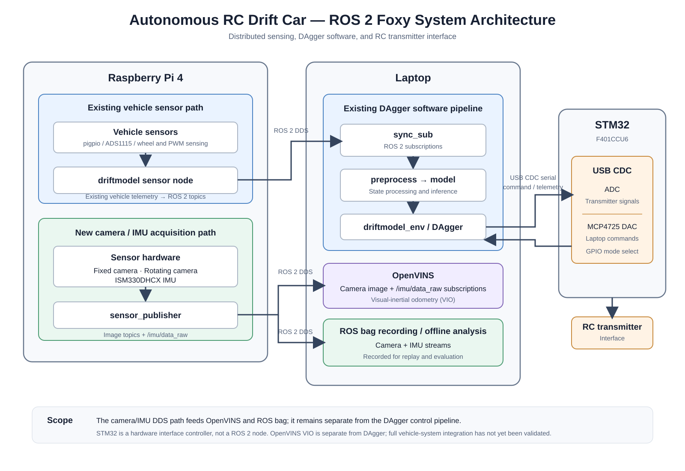
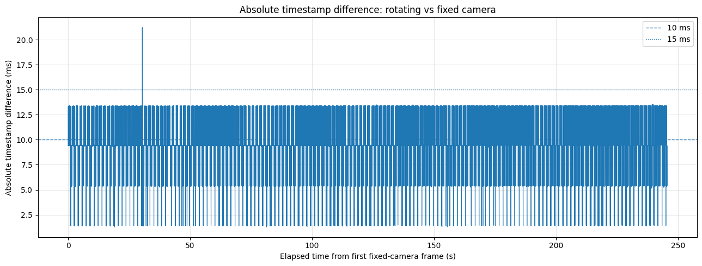

# Autonomous RC Drift Car - ROS 2 Foxy

ROS 2 Foxy version of the 1/10-scale autonomous RC drift car. The architecture is the same as the ROS 1 Noetic prototype (sensor node on the Raspberry Pi 4, behavior cloning with DAgger on the laptop, STM32 board for the radio and motor commands). The code was ported and the problems found in the prototype were fixed along the way.

The Noetic implementation is on the `noetic` branch.

**Status:** The merged `sensor_publisher` package has been built and run on the Raspberry Pi 4. The fixed camera, rotating camera, and IMU streams were captured together on the laptop (`sensor_timestamps.csv`) while the Raspberry Pi followed the laptop clock with chrony. That capture is used for the current timestamp and arrival analysis. The complete vehicle system has not yet been tested as an integrated setup.

## Repository layout

~~~text
foxy/
├── controller/             STM32F401CCU6 firmware (USB CDC, ADC, I2C, MCP4725 DAC)
├── RPi4/
│   ├── driftmodel_msg/     msg/Sensors.msg
│   ├── driftmodel/         vehicle sensor node (C++, pigpio, ADS1115), launch/
│   └── sensor_publisher/   fixed/rotating camera and ISM330DHCX IMU publishers, launch/
└── laptop/
    ├── driftmodel_msg/     msg/{Sensors,CtrlVal,PoseFlag}.msg, srv/Flag.srv
    └── driftmodel/         preprocess, model, usb_receiver, driftmodel_env,
                            train_agent, dagger, pose_flag, sync_sub; launch/, demo.rviz
~~~

## System architecture

The Foxy system is distributed across three devices. The Raspberry Pi 4 acquires vehicle, camera, and IMU data and publishes ROS 2 topics. The laptop runs the DAgger-based software, subscribes to the camera and IMU topics with OpenVINS for visual-inertial odometry, records sensor data with rosbag, and communicates with the RC transmitter interface. The STM32 controller handles the low-level analog signal interface.



The diagram shows two separate sensor paths on the Raspberry Pi:

- **Vehicle sensor path (driftmodel):** the existing vehicle sensor node publishes the data used by the laptop-side ROS 2 software. The Raspberry Pi and laptop exchange ROS 2 messages over the network.
- **Camera / IMU path (sensor_publisher):** the fixed camera, steering-linked rotating camera, and ISM330DHCX publish /camera/fixed/image_raw, /camera/rotating/image_raw, and /imu/data_raw as ROS 2 topics. ROS 2 DDS transports these topics to the laptop, where OpenVINS subscribes to the camera and IMU streams for visual-inertial odometry (VIO). The same streams can also be recorded with rosbag for replay and offline analysis. This OpenVINS path is separate from the existing DAgger perception and control pipeline.

The laptop communicates with the STM32F401CCU6 over USB CDC. The STM32 reads steering and throttle signals from the RC transmitter through ADC and outputs analog steering and throttle commands through two MCP4725 DACs. GPIO inputs select manual transmitter control or laptop-command mode. The STM32 is the radio-interface controller; it is not a ROS 2 node.

The STM32 firmware is carried over from the Noetic setup. The ROS 2 port primarily updates the Raspberry Pi and laptop software. The STM32 project includes its CubeMX configuration, application source, HAL/CMSIS drivers, USB CDC middleware, and the MCP4725 driver. IDE workspace metadata and compiled Debug output are excluded.

Differences from the Noetic layout:

- `msg/` and `srv/` are at the package root and the names are CamelCase (required by ROS 2).
- The laptop-side USB module is Python (`usb_receiver.py`) instead of C++, so there is no `include/` on the laptop.
- Launch files are Python (`launch/*.py`). `demo.rviz` is a minimal rviz2 config (grid and odometry).
- A separate `sensor_publisher` package under `RPi4/` publishes two grayscale camera image topics and raw accelerometer/gyroscope measurements from the ISM330DHCX. Camera V4L2 buffer timestamps and IMU GPIO data-ready event timestamps are converted to the Raspberry Pi ROS clock before publication.
- The two camera capture threads are independent and are not hardware-trigger synchronized. A common ROS clock makes timestamp comparison possible, but does not by itself prove that the physical exposure and IMU sampling instants are aligned. The camera-to-IMU offset is still under evaluation.
- OpenVINS runs from a separate laptop workspace/repository and consumes the camera and IMU topics over ROS 2 DDS; its source is not part of this repository. The OpenVINS VIO output is not yet integrated into the DAgger perception/control pipeline. Camera calibration messages are not published by `sensor_publisher`.
- The recorded data and trained models were not carried over.

## Sensor acquisition and timestamp validation

The Raspberry Pi 4 `sensor_publisher` package combines the two V4L2 camera publishers and the ISM330DHCX IMU publisher.

- **Cameras:** two independent USB camera streams are captured through V4L2, decoded as grayscale `mono8`, and published at a configured maximum rate. The V4L2 buffer timestamp is converted to the node's ROS clock before publication. In the tested 640 x 480 MJPG mode, both cameras accepted 120 FPS while the ROS publisher was limited to 30 FPS; invalid/unmappable camera timestamps are dropped rather than replaced with read-time stamps.
- **IMU:** the ISM330DHCX is configured for 208 Hz accelerometer and gyroscope output (the measured stamp rate is about 221 Hz, see below). Its gyro data-ready signal is routed to INT1; the Raspberry Pi detects the GPIO 23 rising edge through libgpiod, reads the sensor over I2C, converts the kernel event timestamp to ROS time, and publishes `sensor_msgs/Imu` on `/imu/data_raw`.
- **Clock handling:** the camera and IMU timestamp paths convert kernel timestamps to the same Raspberry Pi ROS clock when the kernel clock source can be identified. For camera frames, an invalid or implausibly old V4L2 timestamp causes the frame to be dropped with a warning; the camera publisher does not substitute the read time. A common ROS clock enables timestamp comparison but does not establish physical sensor synchronization.
- **Scope:** this timestamp strategy enables offline comparison of message timestamps. It does not establish hardware synchronization between the two cameras, nor does it prove the physical camera exposure midpoint is aligned with the IMU sampling instant.

### Camera capture mode and USB bandwidth

The two OV9281 camera devices tested on the Raspberry Pi 4 reported MJPG 1280 x 720 at 120/60/30/25 FPS, MJPG 640 x 480 at 120 FPS, and YUYV 640 x 480 at 30 FPS. In the current 640 x 480 MJPG configuration, both drivers accepted 120 FPS although 30 FPS was requested; `max_fps=30` limits the ROS image publication rate to approximately 30 FPS by dropping extra captured frames before JPEG decoding.

YUYV 640 x 480 at 30 FPS requires approximately 18.4 MB/s per camera (36.9 MB/s for two cameras, about 295 Mbps before USB overhead). Because USB camera streams can share an upstream bus, the current MJPG configuration is retained rather than switching both cameras to YUYV without sustained bandwidth testing. MJPEG transfer bandwidth is content- and compression-dependent.

### Time synchronization between the Raspberry Pi and the laptop

Pi stamps can only be compared with laptop times when both clocks agree. The Pi follows the laptop over the Wi-Fi hotspot (laptop `10.42.0.1`). Following a distant internet server over this link left the Pi clock swinging by about +-200 ms.

Laptop (`ntpd`, `/etc/ntp.conf`):

```text
restrict 10.42.0.0 mask 255.255.255.0 nomodify notrap
# optional, when the laptop has no upstream source: serve its own clock
server 127.127.1.0
fudge 127.127.1.0 stratum 10
```

Raspberry Pi (`/etc/chrony/chrony.conf`, with the default `pool` lines commented out):

```text
server 10.42.0.1 iburst minpoll 3 maxpoll 5
makestep 0.1 3
```

Check before recording: `chronyc sources -v` on the Pi must show the laptop as the selected source (`^*`) with `Reach 377`, and `chronyc tracking` shows the current offset. On the laptop, `ntpq -p` should show a system peer; without one `ntpd` may stop serving usable time, which the local-clock fallback above avoids.

### Timestamp capture: `sensor_timestamps.csv`

The timing analysis uses a 245.6-second capture recorded on the laptop while the Pi followed the laptop clock. Each row has `topic`, `header_timestamp_ns` (the Pi stamp) and `receive_monotonic_ns` (the laptop's monotonic clock at receipt). The file holds 54,255 IMU rows and 7,368 rows for each of `/camera/fixed/image_raw/compressed` and `/camera/rotating/image_raw/compressed`. The monotonic receive time is not on the epoch clock of the stamps, so the file gives intervals, drift and relative arrival times, not an absolute delay or clock offset (use `chronyc tracking` for that).

| Stream | Rows | Mean stamp interval | Median stamp interval | Observed rate |
|---|---:|---:|---:|---:|
| Fixed camera | 7,368 | 33.334 ms | 32.018 ms | 30.00 Hz |
| Rotating camera | 7,368 | 33.333 ms | 32.023 ms | 30.00 Hz |
| IMU | 54,255 | 4.527 ms | 4.522 ms | 220.91 Hz |

- **Clock drift:** the lower envelope of (receive time - stamp) in 10-second windows has a slope of -1.2 ppm for the IMU, -2.1 ppm for the fixed camera and -1.1 ppm for the rotating camera. The envelope stays within +-1.4 ms over the capture and shows no steps.
- **Stamp regularity:** IMU stamp intervals have a standard deviation of 0.19 ms, while their receipt intervals have 1.8 ms, so the stamps do not follow the Wi-Fi jitter. Camera stamp intervals vary between about 20 and 48 ms (standard deviation 3.5 ms) around the 33.3 ms mean. No stamp goes backwards in any stream.
- **Missing IMU samples:** estimated from gaps in the stamps, 64 of 54,319 samples (0.12 %) in 54 gap events. No gap occurs in the last 90 seconds. Neither camera stream lost frames (mean stamp interval 33.33 ms).
- **IMU rate:** the nominal output rate is 208.34 Hz, but the stamps show about 221 Hz. The `INTERNAL_FREQ_FINE` register (`0x63`, 0.15 % per step) of this sensor reads `0x29` (+41 steps, +6.15 %), and 208.34 Hz x 1.0615 is about 221 Hz. Read it with `i2cget -y 0 0x6A 0x63`. The observed rate is not a measured sampling clock, only the rate of the data-ready edges.
- **Fixed and rotating cameras:** the absolute same-index timestamp difference was calculated for all 7,368 frame pairs. The median is 9.417 ms; the 95th and 99th percentiles are 13.402 ms and 13.423 ms. There are 2,410 pairs (32.71 %) above 10 ms, and only one pair (0.014 %) above 15 ms. The maximum is 21.210 ms at 30.428 s. Only 3.72 % of pairs are within 5 ms and 67.29 % within 10 ms. This is an index-paired timestamp comparison, not a measurement of physical exposure-time offset. The two capture threads are independent and not hardware-trigger synchronized. The plotted 5-second summary shows the per-bin minimum, median, and maximum; the isolated maximum is visible in the 30–35 s bin.


- **Camera and IMU stamps:** the nearest IMU sample to a frame stamp has a median distance of 1.13 ms (99th percentile 2.24 ms). This is only the IMU spacing; it says nothing about the real exposure offset.
- **Arrival at the laptop:** relative to IMU samples with the same stamp, camera frames arrive a median of 15.7 ms (fixed) and 12.2 ms (rotating) later. When a frame arrives, the IMU samples covering its stamp have not all arrived yet for 0.57 % (fixed) and 0.86 % (rotating) of the frames, so a consumer should wait for the IMU instead of assuming it is already there.

These are timestamp statistics. They do not establish physical synchronization between the cameras or between the cameras and the IMU. The `/ctrl_val` and `/sensors` streams are not part of this capture.


## Device-specific setup

This repository contains the laptop, Raspberry Pi, and STM32 controller files in one Git repository. Each device can use Git sparse checkout to populate only the directory it needs. The instructions below use a normal clone followed by sparse checkout; this avoids the partial-clone options and keeps the commands straightforward.

The commands below assume Ubuntu 20.04, ROS 2 Foxy, Python 3.8, and a fresh checkout. Run the laptop commands on the laptop and the Raspberry Pi commands on the Raspberry Pi. The laptop and Raspberry Pi are separate machines, so each one should have its own clone.

### Laptop

Clone only the laptop-side ROS 2 packages:

```bash
cd ~
git clone -b foxy https://github.com/khds97/autonomous-rc-drift.git

cd ~/autonomous-rc-drift
git sparse-checkout init --cone
git sparse-checkout set foxy/laptop
```

Create the ROS 2 workspace and link the two packages:

```bash
mkdir -p ~/foxy_ws/src

ln -s ~/autonomous-rc-drift/foxy/laptop/driftmodel_msg \
  ~/foxy_ws/src/driftmodel_msg
ln -s ~/autonomous-rc-drift/foxy/laptop/driftmodel \
  ~/foxy_ws/src/driftmodel
```

Install the Python dependencies and build:

```bash
pip3 install torch scikit-learn joblib pynput pyserial numpy

cd ~/foxy_ws
colcon build
source install/setup.bash
```

Launch the laptop node:

```bash
ros2 launch driftmodel driftmodel.launch.py \
  serial_port:=/dev/ACMSTM32 use_rviz:=true
```

### Raspberry Pi 4

Clone only the Raspberry Pi-side ROS 2 packages:

```bash
cd ~
git clone -b foxy https://github.com/khds97/autonomous-rc-drift.git

cd ~/autonomous-rc-drift
git sparse-checkout init --cone
git sparse-checkout set foxy/RPi4
```

Create the ROS 2 workspace and link the packages:

```bash
mkdir -p ~/foxy_ws/src

ln -s ~/autonomous-rc-drift/foxy/RPi4/driftmodel_msg \
  ~/foxy_ws/src/driftmodel_msg
ln -s ~/autonomous-rc-drift/foxy/RPi4/driftmodel \
  ~/foxy_ws/src/driftmodel
```

Install pigpio, then build the packages. `driftmodel` depends on `driftmodel_msg`, which colcon builds first:

```bash
sudo apt install pigpio libpigpiod-if-dev

cd ~/foxy_ws
colcon build --packages-up-to driftmodel
source install/setup.bash
```

Start the pigpio daemon and launch the vehicle sensor node:

```bash
sudo pigpiod
ros2 launch driftmodel driftmodel.launch.py
```

The Raspberry Pi and the laptop each have a `driftmodel_msg` package. Their `Sensors.msg` files must stay identical. See the [`driftmodel`](RPi4/driftmodel/README.md) and [`driftmodel_msg`](RPi4/driftmodel_msg/README.md) READMEs for the parameters, pins and troubleshooting.

For the camera and IMU package build and run instructions, see [RPi4 README](RPi4/README.md).

### Updating an existing sparse checkout

After new commits are pushed to the `foxy` branch, update the checkout on the relevant device. The sparse-checkout selection is retained:

```bash
cd ~/autonomous-rc-drift
git pull origin foxy

cd ~/foxy_ws
colcon build
source install/setup.bash
```

The sparse-checkout selection is retained, so the laptop continues to populate `foxy/laptop` and the Raspberry Pi continues to populate `foxy/RPi4`.

### STM32 controller

The `foxy/controller/` directory contains STM32CubeIDE firmware, not a ROS 2 package. It is kept in the same repository for version control, but it is not added to the ROS 2 workspace with `colcon`. Open the STM32 project in STM32CubeIDE and build/flash it separately.

## Running the learning code

DAgger is started by the `pose_flag` node (it runs `dagger.py`) or directly with `ros2 run driftmodel dagger.py`.

Offline training: `ros2 run driftmodel train_agent.py <model_path> --data_dir <dir>`.

Data and models go to `~/driftmodel/data` and `~/driftmodel/dagger_models` by default.

Sensor node parameters: `publish_rate_hz` (60), `speed_window_s` (0.1), `motor_counts_per_rev` (6), `magnets_per_wheel` (8), `rpm_timeout_s` (0.5).

## Problems found in the Noetic prototype and what changed

I reviewed the Noetic code together with its recorded dataset (12,401 samples, 4 episodes). "Measured" means computed from the dataset, "code" means read from the source only.

### Data and learning

- **`tire_pwm` leaks the steering label** (measured). It is correlated with the steering action (-0.64). In a 5-fold temporal cross-validation the steering MSE goes from 0.069 to 0.167 without it, close to the 0.19 of a predictor that always outputs the mean. If this pin is the steering PWM that is applied to the car, the action leaks into the state. *Now:* excluded from the network input by default, `--use_tire_pwm` turns it back on. Whether it is an input or an output signal is still open.
- **Throttle was split into two channels** (measured). `forward` and `brake` come from one voltage split at about 1.8 V, and the inactive channel is stored as 0, which is not a real value. *Now:* one throttle value, so the action has 2 values (steer, throttle).
- **IMU acceleration was never recorded** (measured). `ax/ay/az` were filled from the angular velocity. *Now:* fixed mapping; the old dataset cannot be used and the loaders reject it.
- **State and action were misaligned** (code). The action was read after a 0.1 s sleep, so it was paired with a state about 0.2 s older. *Now:* states and actions are joined by time stamp with `ApproximateTimeSynchronizer`.
- **Almost no DAgger relabeling** (measured). In autonomous mode the recorder published a constant action, so only 162 samples (1.3%) carry that label and the data is almost all manual driving. *Now:* the controller node publishes whatever the STM32 reports as the action in both modes. **Open problem:** the current STM32 firmware reports the stick voltages only while the transmitter is in control. While the laptop is in control it reports the voltage read back from its own DAC, which is the command the laptop sent, not the operator's input. So no operator labels are recorded in autonomous mode until the firmware also reports the stick ADC values in that mode. Until then, `--exclude_autonomous` drops those samples.
- **The dataset was overwritten at every start** (code), so aggregation only worked inside one run. *Now:* new samples are appended.
- **Training setup** (measured). SGD without shuffling gave a validation error about equal to the mean predictor. Adam lowered the mean error from about 0.44 to 0.31 in the same cross-validation. *Now:* Adam, shuffled batches, and the result is reported next to two baselines (training mean, and "repeat the previous action", steering MSE 0.028).
- **Scaler not saved with the model** (code). *Now:* `model_N.pth` and `model_N_scaler.pkl` are saved together, and actions are de-normalized at inference.

### Sensing

- **Wheel speed** (code, and measured for the coarse values). The counters were cleared every publish cycle (about 34 Hz) but the speed was computed only once per 100 ms, so it was probably about 3 times too low and repeated. `rpm` had only 28 distinct values and `rl_speed`/`rr_speed` only 14. *Now:* each wheel speed comes from the time between two magnet passes (8 magnets, one hall sensor per wheel, falling edges only) and is 0 after `rpm_timeout_s` without a pulse. Pins: FL 19, FR 5, RL 13, RR 6. The motor speed is a rate over a sliding window of real elapsed time.
- **No direction on the wheels** (code, measured). The callbacks only counted up. With one sensor per wheel the direction can not be measured, so wheel speeds are unsigned.
- **ADC scale** (code). The ADS1115 was configured for +-2.048 V but converted with the +-6.144 V step (current about 3 times too high), and a small negative reading turned into about 12 V. *Now:* correct scale, signed value.
- **Unsynchronized counters** (code). The pigpio callback thread and the main loop shared plain variables. *Now:* `std::atomic` for the motor counter, the wheel pulse time/period and the PWM width.
- **Wrong object in the pigpio callbacks** (code). `driver.cpp` passed the `driver` pointer as callback user data, but the callbacks cast it to `wheelSpeed*` / `pwm*`. *Now:* each callback gets its own object.

### Command interface and safety

- **Serial parser** (code). It read integers into `bool` variables with `%d` (writes outside the variable) and used only the first line of the received bytes. *Now:* the newest complete line is parsed.
- **Command limits** (code). The `else if` chain clamped only one value per call and had a typo (`throttle = 0`). *Now:* every value is clamped to 0..3.3 V.
- **No stop command between episodes** (code). While the model trains, the last command stayed active unless the firmware has a timeout. *Now:* a neutral command is sent when an episode ends or the program stops. A firmware-side timeout is still recommended.
- **`driver::init()` / `deinit()`** returned `int` without a return value. *Now:* they return status codes.

### Reproducibility

- Absolute paths such as `/home/ubuntu/ros_noetic_ws/...` were hard-coded in the DAgger script, the launcher node and the launch file. Now data and model directories are command-line options (default `~/driftmodel/`).
- Results should be reported with the baselines above and with repeatable driving tests, not only offline error.

## Preprocessing

16 of the 21 state values are standardized with `StandardScaler`, and both action values are standardized and de-normalized at inference. `pz` and the quaternion are left unscaled because their spread is small or already bounded. In a temporal cross-validation the choice for these columns changed the error by less than the seed-to-seed spread, so it is a design choice, not a measured gain. The physical meaning of the `pz` axis was not checked.

## Notes

- Wheel speeds are `60e6 / (period_us * magnets_per_wheel)`. With 8 magnets and a 0.5 s timeout, speeds below about 15 rpm read 0. A single period is not averaged, so uneven magnet spacing shows up as jitter.
- `Sensors.msg` also carries `fl_speed` / `fr_speed`, but the model still uses only `rl_speed` / `rr_speed` (21 features).
- `motor_counts_per_rev = 6` is an assumption (6 steps per electrical revolution, not multiplied by the pole pairs). Check it against the motor.
- The hall pins use the internal pull-up.
- The PWM measurement is on GPIO 21 (`TIRE`, defined in `driver.cpp`), as in the Noetic version.
- `step()` waits up to 1.0 s (`sample_timeout`) for new data, and the DAgger loop stops after 20 timeouts in a row.

## Testing

| Part | Status |
|---|---|
| Raspberry Pi 4: `sensor_publisher` | Merged package built and launched on the Pi. Both camera topics and `/imu/data_raw` were recorded together on the laptop (`sensor_timestamps.csv`); rates, drift, gaps and arrival times are documented above. The camera-to-IMU offset is still not measured |
| Wheel speed and motor hall decoding (`wheelSpeed.hpp`) | Unit tests on a PC with synthetic pulses: 600-3000 rpm, tick wrap, timeout, late pulse, 4 wheels at different speeds, zero on stop |
| `driver`, `pwm`, `ADS1115`, `I2Cdev` | Compiled with `-Wall -Wextra`. `driver` was linked and run against a stub pigpio |
| Preprocessing, training, DAgger loop, USB parser, environment | Python tests with a fake serial port, a fake environment and stubbed ROS modules. Training was run on the old Noetic data converted to the new format |
| `pubSensorData.cpp`, `driftmodel_node.cpp`, laptop ROS 2 runtime, launch files, `demo.rviz` | Checked for syntax and structure only. The complete vehicle sensor and laptop system has not been tested end-to-end |
| Hardware: camera and ISM330DHCX IMU | Built and run on Raspberry Pi 4; ROS 2 topic publishing verified |
| Hardware: pigpio, ADS1115, STM32 controller and full vehicle integration | Not tested as an integrated system |

## Related

- Repository overview: [`../README.md`](../README.md)
- Noetic implementation: `noetic` branch, `noetic/laptop/driftmodel/README.md`
