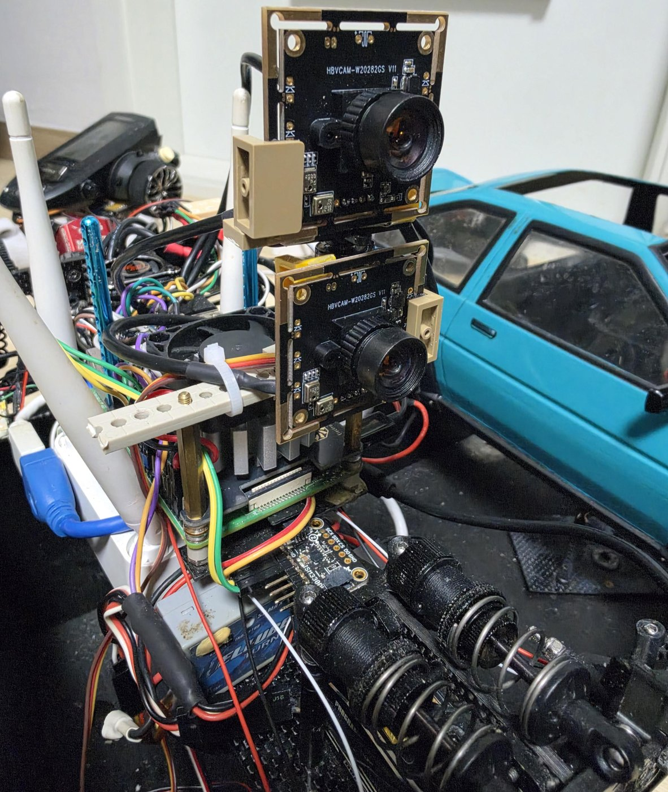
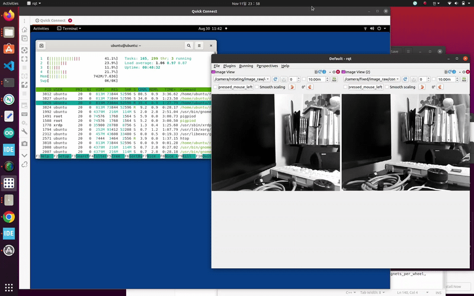

# Dual Camera Publisher (Raspberry Pi 4 / ROS 2 Foxy)

This package publishes images from two USB cameras connected to the Raspberry Pi 4. It is kept separate from the `driftmodel` sensor package.

## Camera arrangement

- **Fixed camera:** mounted to the RC car body and facing forward.
- **Rotating camera:** mounted on a servo so that its viewing direction follows the steering input. The rotating-camera servo receives the same Yokomo Drift Gyro-corrected steering PWM signal as the front steering servo through a Y-cable.

The Y-cable splits the gyro-corrected PWM signal to the two servos. The publisher itself only captures and publishes camera images; it does not command either servo or estimate the camera angle.



Two HBVCAM-W20282GS V11 camera boards (OV9281, monochrome global shutter) are mounted on top of the Raspberry Pi 4.

## Published topics

| Topic | Camera |
|---|---|
| `/camera/fixed/image_raw` | Body-fixed forward-facing camera |
| `/camera/rotating/image_raw` | Steering-linked rotating camera |

The source defaults to **640 × 480** and **30 FPS** per camera. It requests **MJPEG** from each V4L2 device, decodes frames as grayscale, and publishes `mono8` images.

Default device paths are `/dev/video0` (fixed) and `/dev/video2` (rotating). These can be changed with the `fixed_device` and `rotating_device` node parameters.

## Build and run

Install the ROS 2 Foxy dependencies (`image_transport`, `cv_bridge`, `sensor_msgs`, and OpenCV) and the V4L2 development/runtime components available on the Raspberry Pi OS/Ubuntu image.

```bash
cd ~/foxy_ws
colcon build --packages-select camera_publisher
source install/setup.bash
ros2 launch camera_publisher dual_camera.launch.py
```

Check the published streams:

```bash
ros2 topic list | grep '^/camera/'
ros2 topic echo /camera/fixed/image_raw --once
```

## Demo



The two streams (`/camera/rotating/image_raw` on the left, `/camera/fixed/image_raw` on the right) are viewed in `rqt` while `htop` runs next to it to show the CPU load of the publisher.

## Current limitations

- The message timestamp is assigned when the frame is published (`this->now()`), not when the camera captured it.
- The two camera capture threads run independently; hardware synchronization between the streams is not guaranteed.
- `camera_info` calibration messages are not published.
- This package does not publish IMU data. IMU acquisition is outside the scope of this camera publisher.
- The rotating camera's actual servo angle is not measured. Sharing a PWM command with the steering servo does not by itself provide a calibrated camera-angle measurement.
