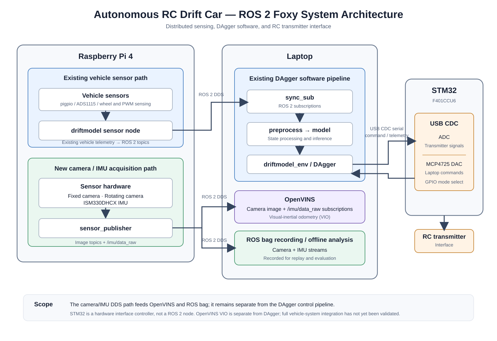

# driftmodel (Raspberry Pi)

Sensor node of the Raspberry Pi 4. It reads the GPIO sensors through pigpio and the current sensor through an ADS1115, and publishes `/sensors` (`driftmodel_msg/msg/Sensors`) at 60 Hz by default.

## System architecture



This package depends on [`driftmodel_msg`](../driftmodel_msg/README.md). Build both in the same workspace.

## What it reads

| Sensor | Pin / address | Notes |
|---|---|---|
| Motor encoder A, B, C | GPIO 25, 7, 8 | 3-phase hall decoder, internal pull-up |
| Wheel hall sensors FL, FR, RL, RR | GPIO 19, 5, 13, 6 | One sensor and 8 magnets per wheel, internal pull-up, falling edge only |
| Steering PWM (`tire_pwm`) | GPIO 17 | Pulse width in us |
| ADS1115 current sensor | I2C bus 1, address 0x48, channel 0 | 128 SPS, read in a background thread |

## Requirements

- ROS 2 Foxy
- pigpio with the daemon interface: `sudo apt install pigpio libpigpiod-if-dev`
- I2C enabled for the ADS1115
- `driftmodel_msg` in the same workspace

The node is only built when `libpigpiod_if2` is found. If it is missing, `colcon build` prints a warning and skips `driftmodel_node`.

## Build

```bash
mkdir -p ~/foxy_ws/src
ln -s ~/autonomous-rc-drift/foxy/RPi4/driftmodel_msg ~/foxy_ws/src/driftmodel_msg
ln -s ~/autonomous-rc-drift/foxy/RPi4/driftmodel     ~/foxy_ws/src/driftmodel

cd ~/foxy_ws
colcon build --packages-up-to driftmodel
source install/setup.bash
```

`--packages-up-to driftmodel` builds `driftmodel_msg` first and then `driftmodel`. Check that the build did not skip the node:

```bash
ls install/driftmodel/lib/driftmodel/driftmodel_node
```

## Run

```bash
sudo pigpiod                                  # once after each boot
ros2 launch driftmodel driftmodel.launch.py
```

Without the launch file (defaults of the node):

```bash
ros2 run driftmodel driftmodel_node
```

Change a parameter on the command line:

```bash
ros2 run driftmodel driftmodel_node --ros-args -p publish_rate_hz:=30.0
```

## Check the output

```bash
ros2 topic echo /sensors
ros2 topic hz /sensors
```

`ros2 topic hz` is a Python tool and can show a lower rate than the real one.

With the wheels lifted and turned by hand, `fl_speed` to `rr_speed` should rise and fall back to 0 half a second after the last pulse.

## Parameters

| Parameter | Default | Meaning |
|---|---|---|
| `publish_rate_hz` | 60.0 | Publish rate. Set it to at least the camera rate (30 Hz) so a sensor message is always close to an image |
| `speed_window_s` | 0.1 | Averaging window of the motor speed |
| `motor_counts_per_rev` | 6.0 | Encoder steps per motor revolution (an assumption, not measured) |
| `magnets_per_wheel` | 8.0 | Magnets on one wheel, equal to pulses per wheel revolution |
| `rpm_timeout_s` | 0.5 | No pulse for this long means wheel speed 0 |

## Timestamp

`header.stamp` is taken at the start of each sampling cycle. The ADS1115 is read in its own thread, because one read blocks for about 10 ms, so `current` can be up to one conversion old. The wheel and motor speeds are computed from pigpio tick times at the moment of sampling.

## Troubleshooting

| Message | Cause |
|---|---|
| `could not connect to pigpiod` | Start the daemon with `sudo pigpiod` |
| `ADS1115 could not be opened on the I2C bus` | I2C is disabled or the sensor is not on bus 1; check with `i2cdetect -y 1` (address 0x48). `current` stays 0 |
| `pigpiod_if2 not found. Skipping driftmodel_node.` | Install `libpigpiod-if-dev` and rebuild |
| `package 'driftmodel_msg' not found` | Build `driftmodel_msg` and source `install/setup.bash` |
