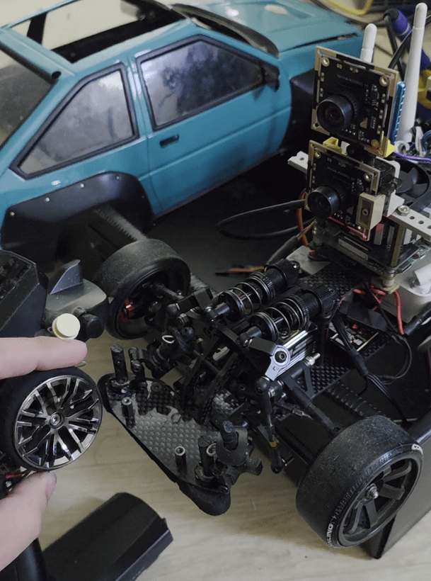
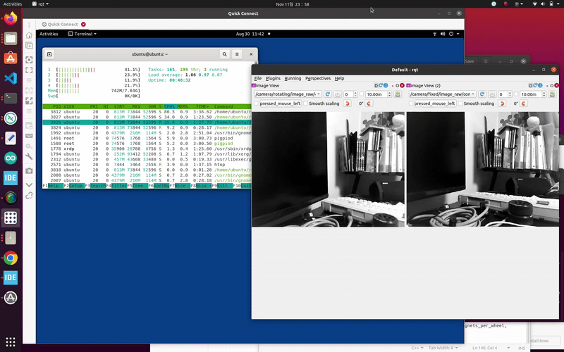

# Sensor Publisher (Raspberry Pi 4 / ROS 2 Foxy)

This package publishes the two USB cameras and the ISM330DHCX IMU from the Raspberry Pi 4. The publishers use capture-related timestamps where the drivers provide them: V4L2 buffer timestamps for camera frames and the kernel GPIO data-ready event timestamp for IMU samples. The timestamps are converted to the Raspberry Pi node clock when the kernel clock source can be identified. This provides a common time base for offline comparison, but does not by itself establish physical sensor synchronization. It is kept separate from the `driftmodel` vehicle sensor package.

## Nodes

| Executable | Description |
|---|---|
| `dual_camera_publisher` | Fixed and rotating camera images (V4L2, MJPEG decoded to `mono8`) |
| `imu_node` | ISM330DHCX accelerometer and gyroscope, read on the data-ready interrupt |

## Published topics

| Topic | Message type | Source |
|---|---|---|
| `/camera/fixed/image_raw` | `sensor_msgs/Image` (mono8) | Body-fixed forward-facing camera |
| `/camera/rotating/image_raw` | `sensor_msgs/Image` (mono8) | Steering-linked rotating camera |
| `/imu/data_raw` | `sensor_msgs/Imu` | Angular velocity (rad/s) and linear acceleration (m/s^2), unmodified |

## Build

The IMU node reads GPIO edge events with libgpiod (1.x API):

```bash
sudo apt install libgpiod-dev gpiod
```

```bash
cd ~/autonomous-rc-drift/foxy/RPi4
source /opt/ros/foxy/setup.bash
colcon build --symlink-install --packages-select sensor_publisher
source install/setup.bash
```

This package replaces the former `camera_publisher` and `imu_publisher` packages. If they were built before, remove their old `build/`, `install/` and `log/` entries so the old executables are not picked up.

## Run

The user running the nodes needs access to `/dev/i2c-0` (the `i2c` group), to `/dev/gpiochip0` (the `gpio` group) and to the camera devices (the `video` group). Log out and back in after changing groups.

Start both publishers:

```bash
ros2 launch sensor_publisher sensors.launch.py
```

Or run them separately:

```bash
ros2 launch sensor_publisher dual_camera.launch.py
ros2 run sensor_publisher imu_node
```

Check the streams and rates:

```bash
ros2 topic list
ros2 topic hz /imu/data_raw
ros2 topic hz /camera/fixed/image_raw
```

## Timestamps

The message header uses a capture-related timestamp rather than the time the ROS message is published.

- **IMU:** the kernel timestamp of the GPIO 23 INT1 rising-edge event. This is the data-ready event time; it is not guaranteed to be the exact internal sampling instant or the midpoint of the sensor's measurement interval.
- **Cameras:** the V4L2 buffer timestamp associated with the frame, before JPEG decode. It represents the driver's frame timestamp and should not be interpreted as a measured exposure midpoint.

Kernel event times are on `CLOCK_REALTIME` or `CLOCK_MONOTONIC` depending on the driver. The nodes check which clock gives a plausible event age (up to 50 ms for the IMU and 200 ms for cameras). Camera frames whose V4L2 timestamp cannot be mapped to a known clock within the allowed age are dropped and a warning is printed; they are not published with a substitute read-time stamp. This avoids mixing capture timestamps with delayed read-time timestamps in the camera stream.

The V4L2 time is the start of the frame, not the middle of the exposure, and the USB transfer adds a small delay. A constant shift can be applied with the `fixed_time_offset_s` and `rotating_time_offset_s` parameters once the camera-to-IMU offset has been measured (positive values move the stamps later). The offset itself is not measured by this package.

When both timestamp paths are successfully mapped, stamps are expressed in the Raspberry Pi node clock. In the camera publisher, an invalid or unmappable kernel timestamp produces a warning and the frame is dropped; it is not published with a read-time replacement. To compare stamps from different computers, their clocks must also be synchronized (for example with chrony).

### Chrony-synchronized subscriber-side capture

The current timing analysis is based on the 201.17-second subscriber-side capture `sensor_sync.csv`, recorded after chrony synchronization between the Raspberry Pi and laptop had been confirmed. The CSV contains 6,036 fixed-camera rows, 6,036 rotating-camera rows, and 44,372 IMU rows.

| Stream | Mean header-stamp interval | Median interval | Observed rate | Mean estimated delay | Median estimated delay |
|---|---:|---:|---:|---:|---:|
| Fixed camera | 33.334 ms | 32.017 ms | 30.00 Hz | 24.58 ms | 24.77 ms |
| Rotating camera | 33.332 ms | 32.023 ms | 30.00 Hz | 26.35 ms | 25.64 ms |
| IMU | 4.533 ms | 4.521 ms | 220.59 Hz | 7.32 ms | 5.37 ms |

The rotating-minus-fixed same-index header timestamp difference had a median of 6.98 ms (5th–95th percentile: 3.01–11.06 ms; maximum absolute difference: 15.10 ms). Nearest-IMU-sample distance medians were 1.127 ms for fixed and 1.131 ms for rotating (95th percentiles: 2.148 ms and 2.154 ms). These are timestamp comparison and sample-proximity statistics, not calibrated sensor offsets or physical synchronization errors. The two camera capture threads are independent and are not hardware-trigger synchronized.

The `estimated_delay_ms` column is calculated from subscriber `receive_wall_time - header_stamp`. Because this capture was recorded after chrony synchronization was confirmed, the two system clocks had a synchronized reference; however, the value still includes the complete delay from the stamped event to subscriber receipt, including processing and transport. It is not network-only latency. The `receive_monotonic` column is measured in seconds on the subscriber computer's monotonic clock and must not be directly subtracted from epoch-based `header_stamp` values.

The IMU's configured output data rate is 208 Hz. The approximately 220.59 Hz value is the observed rate of extracted header timestamps and should not be treated as proof that the physical sensor samples at that rate. The earlier pre-chrony ROS 2 bag export is excluded from this current timing analysis.


## Cameras

### Camera arrangement

- **Fixed camera:** mounted to the RC car body and facing forward.
- **Rotating camera:** mounted on a servo so that its viewing direction follows the steering input. The rotating-camera servo receives the same Yokomo Drift Gyro-corrected steering PWM signal as the front steering servo through a Y-cable.

The Y-cable splits the gyro-corrected PWM signal to the two servos. The publisher itself only captures and publishes camera images; it does not command either servo or estimate the camera angle.


Two HBVCAM-W20282GS V11 camera boards (OV9281, monochrome global shutter) are mounted on top of the Raspberry Pi 4.

### Gyro-linked camera test



The steering is turned with the transmitter wheel (left side of the picture). The front wheels and the rotating camera turn together, because both servos get the same gyro-corrected steering signal.

### Camera settings

The source defaults to **640 x 480** and requests **30 FPS** per camera using **MJPEG**. The driver may accept a different rate depending on the exact format and resolution. On the two OV9281 cameras tested in this setup, `v4l2-ctl --list-formats-ext` reported these modes: MJPG 1280 x 720 at 120/60/30/25 FPS, MJPG 640 x 480 at 120 FPS, and YUYV 640 x 480 at 30 FPS. During the latest dual-camera run, both 640 x 480 MJPG devices accepted 120 FPS even though 30 FPS was requested.

The `max_fps` parameter limits the published rate to 30 FPS by dropping extra captured frames before JPEG decoding. Thus, the current configuration captures at about 120 FPS but publishes at about 30 FPS. This is a deliberate choice to retain MJPEG compression and avoid the much higher USB payload of uncompressed YUYV. At 640 x 480, YUYV 4:2:2 carries 2 bytes per pixel: about 18.4 MB/s per camera at 30 FPS, or 36.9 MB/s for two cameras (about 295 Mbps, before USB protocol overhead). The two USB camera streams may share the available USB bus bandwidth, so changing both to YUYV should only be considered after measuring the actual USB topology and sustained transfer behavior. MJPEG bandwidth varies with image content and compression.

Every 5 seconds the node prints the published frame rate and the camera capture rate. A warning shows the rate accepted by the driver when it differs from the requested `fps`. The modes offered by each device can be listed with `v4l2-ctl -d /dev/video0 --list-formats-ext` and `v4l2-ctl -d /dev/video2 --list-formats-ext`.

| Parameter | Default | Description |
|---|---|---|
| `fixed_device` | `/dev/video0` | Fixed camera device |
| `rotating_device` | `/dev/video2` | Rotating camera device |
| `width`, `height` | `640`, `480` | Frame size |
| `fps` | `30` | Requested frame rate |
| `max_fps` | `30.0` | Limit of the published frame rate, `0` = no limit; extra frames are dropped before decode |
| `fixed_time_offset_s` | `0.0` | Constant stamp shift for the fixed camera |
| `rotating_time_offset_s` | `0.0` | Constant stamp shift for the rotating camera |

### Demo



The two streams (`/camera/rotating/image_raw` on the left, `/camera/fixed/image_raw` on the right) are viewed in `rqt` while `htop` runs next to it to show the CPU load of the publisher.

## IMU

### Connection

| Signal | Connection |
|---|---|
| I2C device | `/dev/i2c-0`, address `0x6A` (WHO_AM_I `0x6B`) |
| INT1 | GPIO 23 (header pin 16) on `gpiochip0` |

The sensor raises a short pulse on INT1 for every new sample. The node blocks on that GPIO edge, reads the sample over I2C and publishes it. To check the wiring with the node stopped, configure the sensor by hand and watch the pin with `gpiomon --rising-edge gpiochip0 23`.

### Sensor configuration

- Accelerometer: 208 Hz, +/-4 g
- Gyroscope: 208 Hz, +/-1000 dps
- Block data update and register address auto-increment enabled
- The sensor is software-reset at startup
- Gyroscope data-ready is routed to INT1. The node waits for rising-edge events on GPIO 23; on each handled event it reads the gyro and accelerometer output registers. The accelerometer is configured to the same output data rate.

If you change the output rate or the full-scale ranges, update the sensitivity constants in `src/imu_node.cpp` as well.

The frame ID is `imu_link`. Orientation is not estimated (`orientation_covariance[0] = -1`). The node logs the publish rate and the number of missed edge events every 5 seconds. The configured output data rate is 208 Hz, but the observed publish rate should be measured from node logs or message header timestamps rather than assumed to equal the configured ODR. With the IMU lying still, gyroscope values should be near zero and the acceleration magnitude near 9.8 m/s^2.

| Parameter | Default | Description |
|---|---|---|
| `i2c_device` | `/dev/i2c-0` | I2C bus device |
| `frame_id` | `imu_link` | Frame ID of the published messages |
| `gpio_chip` | `gpiochip0` | GPIO chip the INT1 pin is connected to |
| `gpio_line` | `23` | Line offset (BCM number on a Raspberry Pi 4) |
| `event_timeout_ms` | `200` | Warn if no edge arrives for this long |

## Current limitations

- The two camera capture threads run independently; hardware synchronization between the streams is not guaranteed.
- The camera-to-IMU time offset is not measured here, only the constant shift parameters are provided.
- `camera_info` calibration messages are not published.
- IMU axes are published as reported by the sensor, with no vehicle-frame rotation, and gyroscope and accelerometer biases are not corrected.
- The rotating camera's actual servo angle is not measured. Sharing a PWM command with the steering servo does not by itself provide a calibrated camera-angle measurement.
