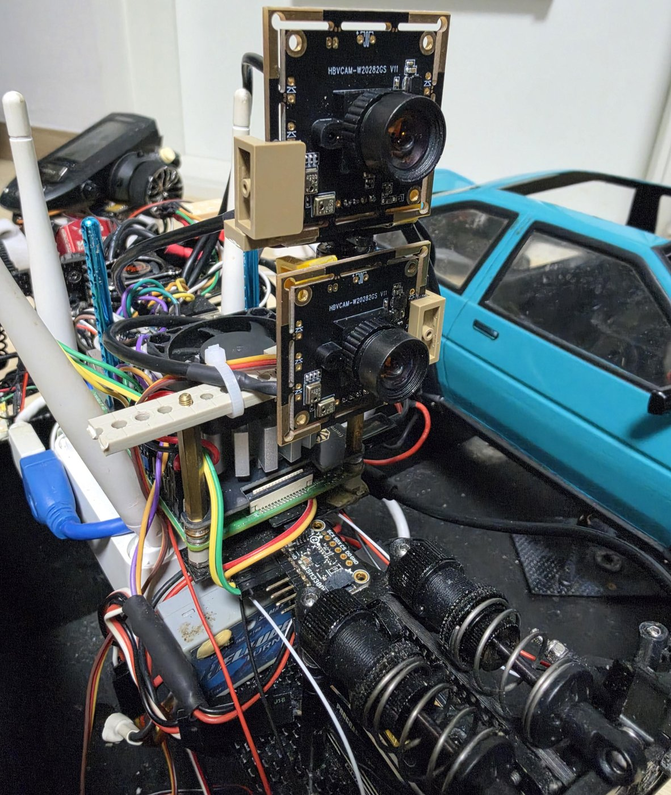

# Sensor Publisher (Raspberry Pi 4 / ROS 2 Foxy)

This package publishes the two USB cameras and the ISM330DHCX IMU from the Raspberry Pi 4. Both publishers stamp their data with the time it was captured, on the same clock, so camera frames and IMU samples can be lined up later. It is kept separate from the `driftmodel` vehicle sensor package.

## Nodes

| Executable | Description |
|---|---|
| `dual_camera_publisher` | Fixed and rotating camera images (V4L2, MJPEG decoded to `mono8`) |
| `imu_node` | ISM330DHCX accelerometer and gyroscope, read on the data-ready interrupt |

## Published topics

| Topic | Message type | Source |
|---|---|---|
| `/camera/fixed/image_raw` | `sensor_msgs/Image` (mono8) | Body-fixed forward-facing camera |
| `/camera/rotating/image_raw` | `sensor_msgs/Image` (mono8) | Steering-linked rotating camera |
| `/imu/data_raw` | `sensor_msgs/Imu` | Angular velocity (rad/s) and linear acceleration (m/s^2), unmodified |

## Build

The IMU node reads GPIO edge events with libgpiod (1.x API):

```bash
sudo apt install libgpiod-dev gpiod
```

```bash
cd ~/autonomous-rc-drift/foxy/RPi4
source /opt/ros/foxy/setup.bash
colcon build --symlink-install --packages-select sensor_publisher
source install/setup.bash
```

This package replaces the former `camera_publisher` and `imu_publisher` packages. If they were built before, remove their old `build/`, `install/` and `log/` entries so the old executables are not picked up.

## Run

The user running the nodes needs access to `/dev/i2c-0` (the `i2c` group), to `/dev/gpiochip0` (the `gpio` group) and to the camera devices (the `video` group). Log out and back in after changing groups.

Start both publishers:

```bash
ros2 launch sensor_publisher sensors.launch.py
```

Or run them separately:

```bash
ros2 launch sensor_publisher dual_camera.launch.py
ros2 run sensor_publisher imu_node
```

Check the streams and rates:

```bash
ros2 topic list
ros2 topic hz /imu/data_raw
ros2 topic hz /camera/fixed/image_raw
```

## Timestamps

Camera frames and IMU samples are stamped with the time the data was captured, not the time it was published, and both are converted to the node clock (the system clock) of the Pi.

- **IMU:** the time of the INT1 edge reported by the kernel.
- **Cameras:** the V4L2 buffer time of the frame, i.e. when the frame arrived over USB, before the JPEG decode.

Kernel event times are on `CLOCK_REALTIME` or `CLOCK_MONOTONIC` depending on the driver. The nodes check which one gives a plausible age (up to 50 ms for the IMU, 200 ms for the cameras) and use it. If neither fits, the node falls back to the time of reading and prints a warning; the warning means the stamps of that stream are late and jittery.

The V4L2 time is the start of the frame, not the middle of the exposure, and the USB transfer adds a small delay. A constant shift can be applied with the `fixed_time_offset_s` and `rotating_time_offset_s` parameters once the camera-to-IMU offset has been measured (positive values move the stamps later). The offset itself is not measured by this package.

To compare stamps from different computers, their clocks have to be synchronized (for example with chrony). Stamps from the same Pi are on one clock already.

## Cameras

### Camera arrangement

- **Fixed camera:** mounted to the RC car body and facing forward.
- **Rotating camera:** mounted on a servo so that its viewing direction follows the steering input. The rotating-camera servo receives the same Yokomo Drift Gyro-corrected steering PWM signal as the front steering servo through a Y-cable.

The Y-cable splits the gyro-corrected PWM signal to the two servos. The publisher itself only captures and publishes camera images; it does not command either servo or estimate the camera angle.



Two HBVCAM-W20282GS V11 camera boards (OV9281, monochrome global shutter) are mounted on top of the Raspberry Pi 4.

### Gyro-linked camera test


The steering is turned with the transmitter wheel (left side of the picture). The front wheels and the rotating camera turn together, because both servos get the same gyro-corrected steering signal.

### Camera settings

The source defaults to **640 x 480** and **30 FPS** per camera. It requests **MJPEG** from each V4L2 device, decodes frames as grayscale, and publishes `mono8` images. The capture loops are paced by the cameras: each loop waits for the next frame.

Some cameras ignore the requested frame rate and deliver more (the OV9281 boards can run at 60 or 120 FPS). The `max_fps` parameter limits the published rate by dropping the extra frames before they are decoded, which saves CPU and network bandwidth. Every 5 seconds the node prints the published frame rate and the rate the camera delivers. If the driver does not accept the requested `fps`, a warning shows the rate it accepted. The modes a camera offers can be listed with `v4l2-ctl -d /dev/video0 --list-formats-ext`.

| Parameter | Default | Description |
|---|---|---|
| `fixed_device` | `/dev/video0` | Fixed camera device |
| `rotating_device` | `/dev/video2` | Rotating camera device |
| `width`, `height` | `640`, `480` | Frame size |
| `fps` | `30` | Requested frame rate |
| `max_fps` | `30.0` | Limit of the published frame rate, `0` = no limit |
| `fixed_time_offset_s` | `0.0` | Constant stamp shift for the fixed camera |
| `rotating_time_offset_s` | `0.0` | Constant stamp shift for the rotating camera |

### Demo


The two streams (`/camera/rotating/image_raw` on the left, `/camera/fixed/image_raw` on the right) are viewed in `rqt` while `htop` runs next to it to show the CPU load of the publisher.

## IMU

### Connection

| Signal | Connection |
|---|---|
| I2C device | `/dev/i2c-0`, address `0x6A` (WHO_AM_I `0x6B`) |
| INT1 | GPIO 23 (header pin 16) on `gpiochip0` |

The sensor raises a short pulse on INT1 for every new sample. The node blocks on that GPIO edge, reads the sample over I2C and publishes it. To check the wiring with the node stopped, configure the sensor by hand and watch the pin with `gpiomon --rising-edge gpiochip0 23`.

### Sensor configuration

- Accelerometer: 208 Hz, +/-4 g
- Gyroscope: 208 Hz, +/-1000 dps
- Block data update and register address auto-increment enabled
- The sensor is software-reset at startup
- Gyroscope data-ready is routed to INT1 as a short pulse (one rising edge per sample). The accelerometer runs at the same output rate, so both are read after each edge.

If you change the output rate or the full-scale ranges, update the sensitivity constants in `src/imu_node.cpp` as well.

The frame ID is `imu_link`. Orientation is not estimated (`orientation_covariance[0] = -1`). The node logs the publish rate and the number of missed samples every 5 seconds; with the IMU lying still it should be close to 208 Hz, the gyroscope values close to zero and the acceleration magnitude close to 9.8 m/s^2.

| Parameter | Default | Description |
|---|---|---|
| `i2c_device` | `/dev/i2c-0` | I2C bus device |
| `frame_id` | `imu_link` | Frame ID of the published messages |
| `gpio_chip` | `gpiochip0` | GPIO chip the INT1 pin is connected to |
| `gpio_line` | `23` | Line offset (BCM number on a Raspberry Pi 4) |
| `event_timeout_ms` | `200` | Warn if no edge arrives for this long |

## Current limitations

- The two camera capture threads run independently; hardware synchronization between the streams is not guaranteed.
- The camera-to-IMU time offset is not measured here, only the constant shift parameters are provided.
- `camera_info` calibration messages are not published.
- IMU axes are published as reported by the sensor, with no vehicle-frame rotation, and gyroscope and accelerometer biases are not corrected.
- The rotating camera's actual servo angle is not measured. Sharing a PWM command with the steering servo does not by itself provide a calibrated camera-angle measurement.
