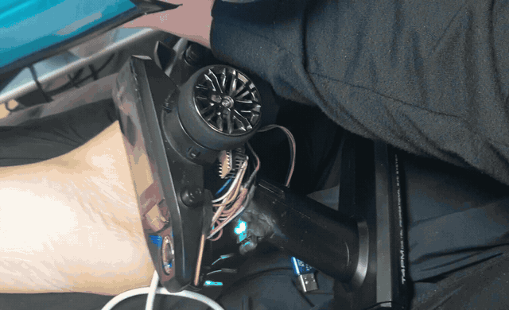
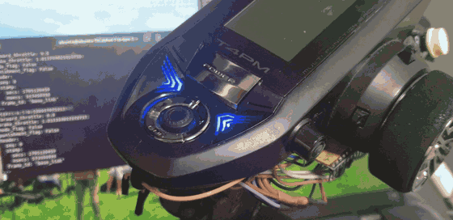
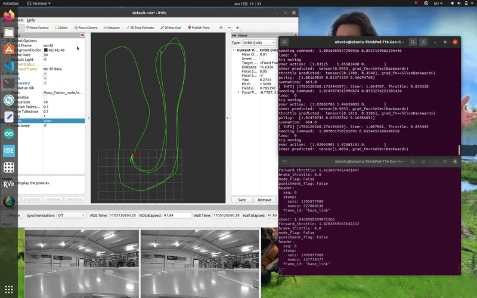

# Autonomous RC Drift Car — ROS Noetic System

## 1. Project Overview

This branch contains the original ROS Noetic implementation of an autonomous rear-wheel-drive RC drift car.

The system is divided across three main parts:

- **RC car:** The physical vehicle, sensors, actuators, and embedded control hardware.
- **Raspberry Pi 4:** On-vehicle computer for sensor acquisition and camera operation.
- **Laptop:** Remote computer for visual-inertial odometry, vehicle-state processing, control, and learning-based policy development.

The Raspberry Pi and laptop communicate through a ROS network. The laptop sends steering and throttle commands to the vehicle through a USB-connected STM32 controller.

The overall design separates on-vehicle sensing from higher-level processing and control.

## 2. System Architecture

```text
                       ROS network
       ┌──────────────────────────────────────────┐
       │                                          │
       ▼                                          ▼
┌──────────────────────┐                 ┌──────────────────────┐
│ Raspberry Pi 4       │                 │ Laptop               │
│ On-vehicle computer  │                 │ ROS Noetic           │
│                      │                 │                      │
│  OAK-D camera        │── camera / IMU ─▶│  VINS-Fusion         │
│  Stereo + IMU        │                 │  Loop Fusion         │
│                      │                 │  Odometry processing │
│  Wheel / tire        │── /sensors ─────▶│  DriftEnv            │
│  speed sensors       │                 │  DAgger / NN policy  │
│  RPM, current        │                 │                      │
│                      │                 │  USB serial          │
│  ROS sensor node     │                 │       │              │
└──────────────────────┘                 └───────┼──────────────┘
                                                 │
                                          Steering / throttle
                                                 │
                                                 ▼
                                      ┌──────────────────────┐
                                      │ STM32 controller     │
                                      │ USB serial interface │
                                      └──────────┬───────────┘
                                                 │
                                                 ▼
                                      ┌──────────────────────┐
                                      │ RC car actuators     │
                                      │ Steering / ESC       │
                                      └──────────────────────┘
```

**Data flow in brief**

1. The Raspberry Pi 4 acquires vehicle sensor measurements and publishes them as ROS messages.
2. The OAK-D stereo camera and IMU provide visual and inertial data.
3. The laptop processes the camera/IMU stream with VINS-Fusion and Loop Fusion to obtain vehicle odometry.
4. The laptop combines odometry, IMU, vehicle sensors, and control feedback for the vehicle-state representation.
5. The control process generates steering and throttle commands.
6. Commands are transmitted over USB serial to the STM32 controller, which interfaces with the RC car's actuators.

## 3. Hardware and Software Responsibilities

| Component | Main responsibility | Related code |
|---|---|---|
| RC car | Steering and motor actuation; vehicle-mounted sensors | Vehicle hardware and embedded controller |
| Raspberry Pi 4 | Read wheel/tire signals and current; publish sensor data; run camera driver | `RPi4/driftmodel` |
| Laptop | Camera/IMU processing, odometry, state construction, control and learning | `laptop/driftmodel` |
| STM32 | Receive steering/throttle commands over USB serial and interface with vehicle electronics | Accessed by laptop through `USBReceiver` |
| Custom ROS messages | Define the vehicle sensor data exchanged between nodes | `RPi4/driftmodel_msg`, `laptop/driftmodel_msg` |

## 4. Raspberry Pi 4 — On-Vehicle Sensing

The Raspberry Pi package is located at:

`RPi4/driftmodel/`

Its main responsibilities are:

- Initialize GPIO inputs through pigpio.
- Count encoder and hall-sensor transitions for wheel-related measurements.
- Measure tire PWM input.
- Read current measurements through an ADS1115 ADC.
- Publish the acquired values as the custom ROS message `driftmodel_msg/sensors`.
- Launch the OAK-D stereo-inertial camera node.

The sensor message contains:

| Field | Description |
|---|---|
| `rpm` | RPM measurement |
| `tire_pwm` | Tire-related PWM measurement |
| `rl_speed` | Rear-left wheel speed |
| `rr_speed` | Rear-right wheel speed |
| `current` | Current measurement |
| `header` | Timestamp and frame information |

The sensor publisher runs at approximately 34 Hz in the current implementation.

Related packages:

- `RPi4/driftmodel_msg/`: custom sensor message definition.
- `RPi4/driftmodel/launch/driftmodel.launch`: launches the sensor node and stereo-inertial camera node.

## 5. Laptop — Perception, State Processing and Control

The laptop package is located at:

`laptop/driftmodel/`

The launch configuration starts the camera image republishers, RViz, VINS-Fusion, Loop Fusion, and supporting control/pose nodes.

The learning environment in `src/driftmodel_env.py` subscribes to synchronized ROS data:

- `/loop_fusion_node/odometry_rect`
- `/sensors`
- `/stereo_inertial_publisher/imu`
- `/ctrl_val`

These inputs are combined into a 21-dimensional vehicle-state vector for the learning-based controller. The action vector consists of steering, forward throttle, and brake throttle.

The detailed state representation, neural-network architecture, DAgger workflow, and code-review notes are documented separately in the [Drift Model README](laptop/driftmodel/README.md).

## 6. Laptop-to-Vehicle Command Interface

The laptop communicates with the STM32 controller through a USB serial connection.

The current `USBReceiver` implementation:

- Opens the serial device `/dev/ACMSTM32`.
- Uses a baud rate of 115200.
- Sends steering and throttle values as newline-separated text.
- Receives steering, throttle, mode, and punishment feedback from the serial stream.

This creates the command path:

```text
Laptop control process
        │
        ▼
USBReceiver
        │ USB serial
        ▼
STM32 controller
        │
        ▼
RC car steering / motor control
```

The STM32 is therefore the low-level interface between the laptop's ROS control software and the vehicle electronics.

## 7. Repository Structure

```text
noetic/
├── README.md
├── RPi4/
│   ├── driftmodel/
│   │   ├── include/       # Sensor and hardware interface headers
│   │   ├── launch/        # Raspberry Pi launch configuration
│   │   └── src/           # GPIO, ADC, wheel-speed and ROS publisher code
│   └── driftmodel_msg/    # Vehicle sensor message definition
└── laptop/
    ├── driftmodel/
    │   ├── launch/        # Camera, odometry and visualization launch setup
    │   └── src/           # Environment, USB interface, model and DAgger code
    └── driftmodel_msg/    # Matching ROS message package
```

## 8. Development History and Scope

This branch preserves the original ROS Noetic system and its distributed Raspberry Pi/laptop architecture.

The camera configuration and onboard hardware arrangement were later redesigned as part of a new development direction, with software work moving toward ROS 2 Foxy. The Noetic implementation is retained as a reference for the earlier vehicle platform, sensor interface, communication flow, and learning-based drift-control experiments.

This document describes the architecture represented by the current repository. Hardware wiring, firmware behavior, network configuration, and runtime launch dependencies should be checked against the actual vehicle setup before reproducing the system.

## 9. Legacy Implementation Review — Known Issues

The following issues were identified by reviewing the source code in this Noetic branch. They are documented as limitations of the legacy implementation; they are not presented as fixes already completed.

The current development direction is to address these areas during the ROS 2 Foxy transition. The Noetic branch is retained as a historical reference, so the original implementation is intentionally preserved.

### 9.1 Critical Runtime and Measurement Issues

| Area | File | Observed issue | Potential impact |
|---|---|---|---|
| GPIO callback context | `RPi4/driftmodel/src/driver.cpp`, `RPi4/driftmodel/src/wheelSpeed.cpp`, `RPi4/driftmodel/src/pwm.cpp` | `callback_ex()` receives `this` from the `driver` object, while the static callback wrappers cast the user pointer to `wheelSpeed*` or `pwm*`. | The callback may access an object through an incompatible pointer, causing undefined behavior or memory corruption. The callback context should refer to the actual receiver object. |
| Encoder sampling | `RPi4/driftmodel/src/wheelSpeed.cpp`, `RPi4/driftmodel/src/driver.cpp` | `calcRpm()` updates only after at least 100 ms, but `setZero()` is called after every sensor publish cycle (approximately 34 Hz). | Counts accumulated during cycles where RPM is not recalculated can be discarded. The calculated speed can therefore be inaccurate or remain stale. |
| Encoder timing | `RPi4/driftmodel/src/wheelSpeed.cpp` | The speed calculation divides pulse counts by a fixed 0.1-second interval instead of using the measured elapsed time. | Timing jitter and delayed loop execution can introduce speed estimation error. |
| Shared encoder counters | `RPi4/driftmodel/src/wheelSpeed.cpp` | GPIO callbacks update static counters while the ROS publishing loop reads and resets them, without synchronization. | Concurrent access can produce inconsistent measurements and data races. |

### 9.2 Control and Communication Issues

| Area | File | Observed issue | Potential impact |
|---|---|---|---|
| Command range validation | `laptop/driftmodel/src/usb_receiver.cpp` | The steering/throttle limits are checked in a single `if / else if` chain, so all bounds are not independently enforced in one call. The lower-bound throttle branch assigns to `throttle` instead of the `throttle_` argument. | Out-of-range command values may be transmitted. |
| Serial receive parsing | `laptop/driftmodel/src/usb_receiver.cpp` | The code reads whatever bytes are currently available and parses them with `sscanf()`, without checking the number of successfully parsed fields or handling incomplete messages. | Partial serial packets can leave feedback variables stale or inconsistent. |
| Serial initialization | `laptop/driftmodel/src/usb_receiver.cpp` | The serial port is opened in the constructor without local error handling. | A missing device or failed connection can interrupt node initialization. |

### 9.3 Learning Pipeline and Environment Issues

| Area | File | Observed issue | Potential impact |
|---|---|---|---|
| Training/inference preprocessing | `laptop/driftmodel/src/train_agent.py`, `laptop/driftmodel/src/dagger.py` | Training data is standardized with `StandardScaler`, but the scaler is not saved and DAgger inference passes the unscaled `next_state` to the model. | The model receives inputs with a different distribution during inference from the one used during training. |
| Dataset split ratio | `laptop/driftmodel/src/train_agent.py` | `frac` is used as the validation fraction. The standalone training path passes `frac=0.9`, leaving 10% for training and 90% for validation. | The resulting training set may be much smaller than intended. |
| Validation usage | `laptop/driftmodel/src/train_agent.py` | Validation inputs are prepared, but `train_model()` does not use `X_valid` or `y_valid` to evaluate the model. | There is no validation-based performance measurement or model-selection step in this training function. |
| Reward state | `laptop/driftmodel/src/driftmodel_env.py` | `self.reward` is assigned conditionally in `step()` and is not reset at the beginning of each step. | A reward from a previous step can persist when none of the current conditions assigns a new value. |
| Observation reset | `laptop/driftmodel/src/driftmodel_env.py` | `reset()` returns the existing observation without waiting for or constructing a fresh synchronized sensor observation. | The first state after reset may be stale. |
| Model checkpoint handling | `laptop/driftmodel/src/dagger.py` | The script saves a newly initialized model to `model_4.pth` before starting the loop, even though the loop initially loads `model_3.pth`. | An existing `model_4.pth` checkpoint can be overwritten at startup. |

### 9.4 Build and Package Configuration

| Area | File | Observed issue | Potential impact |
|---|---|---|---|
| XML syntax | `laptop/driftmodel/package.xml` | The final `exec_depend` entry has an extra `>` after its closing tag. | The package manifest is malformed XML and may prevent package parsing or building. |
| Initialization return values | `RPi4/driftmodel/src/driver.cpp` | `driver::init()` and `driver::deinit()` are declared to return `int`, but successful execution paths do not return a value. | Calling code cannot rely on a defined return value; this should be corrected when the driver lifecycle is redesigned. |

### 9.5 Planned Direction for the Foxy Version

The issues above will be treated as migration and redesign tasks rather than changes to the archived Noetic implementation.

Planned areas of work:

1. **Sensor acquisition:** Use correct callback contexts, synchronized counter access, and elapsed-time-based velocity calculation.
2. **Control interface:** Add independent command bounds checking and robust serial packet framing/parsing.
3. **State construction:** Define a consistent state schema and ensure reset returns a fresh observation.
4. **Learning pipeline:** Save and reuse preprocessing parameters, verify train/validation split settings, and measure validation performance.
5. **Software structure:** Correct package metadata and make initialization/shutdown behavior explicit.

> **Review scope:** This review is based on static inspection of the source files currently present in this branch. The code was not built or executed as part of this review, so runtime behavior and hardware-dependent symptoms have not been experimentally verified.


## 10. Demonstrations

These recordings show the RC transmitter interface, control-mode switching, and ROS vehicle-sensor visualization. GIFs are included for quick previews; the original MP4 recordings are provided separately for full-resolution review.

### 10.1 Laptop-Driven RC Transmitter Control



[View original MP4](original_videos/01_laptop_to_rc_transmitter_control.mp4)

The laptop generates steering and throttle commands and sends them to the STM32 board. The STM32 outputs corresponding analog signals through its DAC, which operate the RC transmitter. The transmitter then sends the control signals wirelessly to the RC car.

```text
Laptop command values
        │
        ▼
   STM32 (DAC)
        │
        ▼
   RC transmitter
        │ Wireless control
        ▼
      RC car
```

### 10.2 Manual Input and Laptop-Control Mode Switching



[View original MP4](original_videos/02_manual_and_laptop_control_mode_switching.mp4)

The STM32 reads the steering and throttle signals from the RC transmitter through its ADC. Operating a separate switch changes the control mode: the system can use the transmitter input or switch to laptop-generated commands, which are output through the STM32 DAC to the transmitter.

This recording demonstrates the input-reading path and the changeover between manual and laptop-driven control.

```text
RC transmitter ── analog input ──▶ STM32 (ADC)
                                      │
                               Mode selection
                                      │
Laptop command ───────────────────────┤
                                      ▼
                                STM32 (DAC)
                                      │
                                      ▼
                               RC transmitter
                                      │
                                      ▼
                                    RC car
```

### 10.3 ROS Vehicle Sensor Data Visualization



[View original MP4](original_videos/03_ros_vehicle_sensor_data_visualization.mp4)

This recording shows examples of the vehicle data acquired by the sensing system and visualized through the ROS-based software. It provides a visual reference for the types of sensor measurements used by the project.

> **Media files:** Place the three GIF files in `noetic/media/` and the three original MP4 files in `noetic/original_videos/` using the filenames shown above.
